<p align="center">
  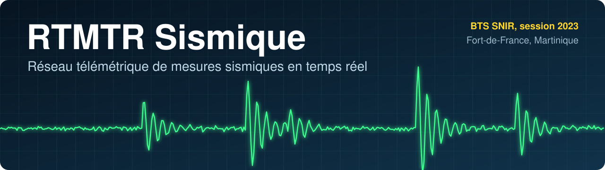
</p>

<p align="center">
  
  
  
  
  
</p>

<p align="center">
  <a href="docs/Synthese_projet.pdf"><b>Synthèse en 2 pages</b></a> &nbsp;|&nbsp;
  <a href="docs/Revue_3_Etudiant3.pdf">Revue de projet</a> &nbsp;|&nbsp;
  <a href="docs/Rapport_projet_E6-2.pdf">Rapport complet</a> &nbsp;|&nbsp;
  <a href="docs/Presentation_projet_Etudiant1.pdf">Présentation</a>
</p>

Un réseau de stations connectées mesure les vibrations du sol et leur position, puis présente ces relevés sous forme de sismogrammes. C'est le projet technique de l'épreuve E6-2 du **BTS SNIR, session 2023**, réalisé à quatre au lycée Joseph Gaillard de Fort-de-France pour l'entreprise Vision Informatique.

<p align="center">
  
</p>

## Pourquoi ce projet

La Martinique est exposée aux séismes, au volcanisme, aux tsunamis, aux glissements de terrain et aux lahars. En lien avec la Collectivité territoriale de Martinique, le projet vise un observatoire d'activité sismique qui sert aussi à sensibiliser les collégiens à ces risques.

Le cahier des charges demande que chaque station transmette ses relevés et sa position. Si le réseau coupe, elle garde ses données et les renvoie plus tard. L'utilisateur peut observer le temps réel comme les périodes passées.

## Comment ça marche

<p align="center">
  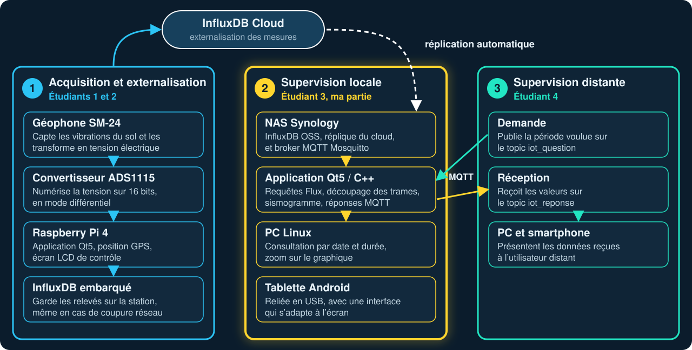
</p>

<details>
<summary>Voir le synoptique d'origine du cahier des charges</summary>
<br>
<p align="center">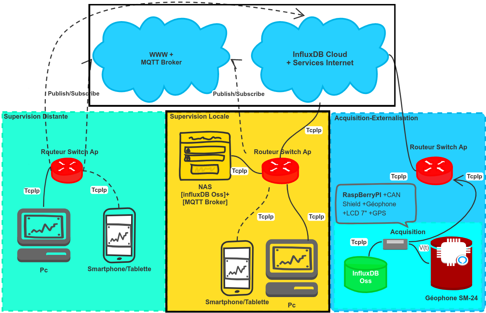</p>
</details>

## Ma partie, la supervision locale

J'ai développé en C++ avec Qt5 l'application qui lit les mesures dans InfluxDB, trace le sismogramme de la période choisie, affiche la position de la station et répond seule aux demandes de la supervision distante.

<p align="center">
  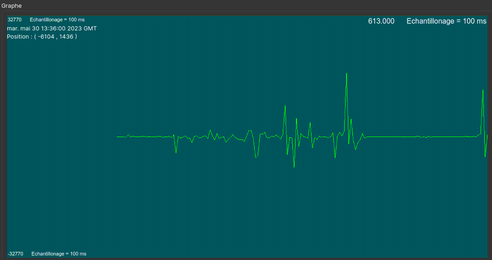
  <br>
  <em>Application finale : une minute de mesures, avec la date, la position de la station et un échantillon toutes les 100 ms.</em>
</p>

### Le dialogue avec la supervision distante

<p align="center">
  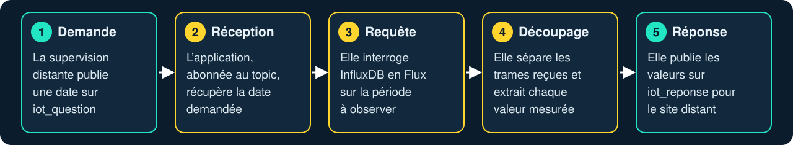
</p>

### Comment je l'ai construite

<p align="center">
  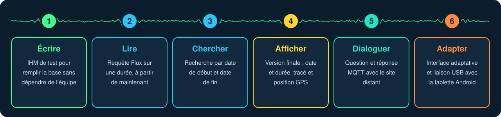
</p>

Pour ne pas dépendre de l'avancement de mes coéquipiers, j'ai commencé par une interface qui écrit des valeurs de test dans la base. J'ai pu développer et tester la lecture tout de suite, puis finaliser l'application une fois leurs parties terminées.

### L'interface finale

<table>
<tr>
<td width="62%">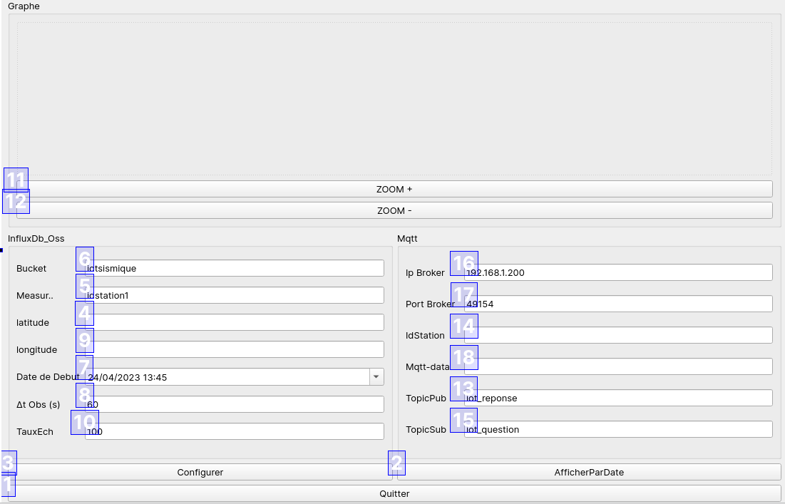</td>
<td>
<b>Graphique</b><br>Tracé et zoom (11, 12)<br><br>
<b>InfluxDB</b><br>Base, station, date de début, durée, échantillonnage (4 à 10)<br><br>
<b>MQTT</b><br>Broker, topics, station, donnée reçue (13 à 18)<br><br>
<b>Actions</b><br>Afficher, configurer, quitter (1 à 3)
</td>
</tr>
</table>

## Les choix techniques

| Choix | Pourquoi |
|---|---|
| **InfluxDB** | Une base de séries temporelles est conçue pour des mesures horodatées et pour les requêtes par période. |
| **`iotsismique` → `idstation1` → `mesure`, `latitude`, `longitude`** | Le measurement identifie la station. Une nouvelle station s'ajoute sans changer la structure. |
| **MQTT** | Les deux supervisions échangent par topics (`iot_question`, `iot_reponse`) à travers un broker, sans se connecter directement l'une à l'autre. |
| **Qt5 / C++** | Le même framework sert sur le PC Linux et sur la tablette Android, et l'interface s'adapte à l'écran. |

```flux
from(bucket: "iotsismique")
  |> range(start: -3m)
  |> filter(fn: (r) => r._measurement == "idstation1")
  |> filter(fn: (r) => r._field == "mesure")
```

## Le signal capté

<p align="center">
  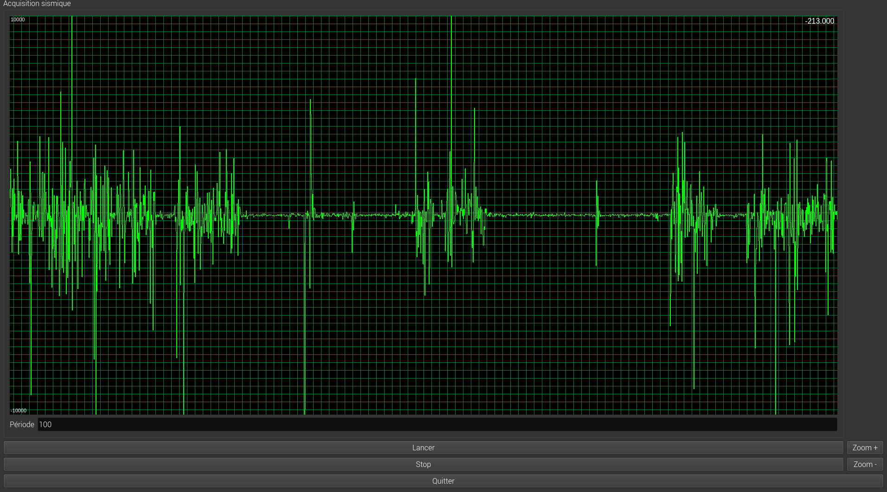
  <br>
  <em>Validation de l'acquisition par Étudiant 1 : le signal du géophone SM-24 en sortie du convertisseur ADS1115.</em>
</p>

## Les compétences mises en œuvre

| Domaine | Ce que j'ai fait |
|---|---|
| **Développement** | Application C++ / Qt5, interface graphique, tracé de données, signaux et slots |
| **Données** | Écriture et lecture InfluxDB, requêtes Flux, découpage des trames CSV renvoyées par le serveur |
| **Réseau** | Publication et souscription MQTT, dialogue automatique avec un autre sous-système |
| **Mobile** | Interface adaptative, liaison USB et débogage avec `adb` sur tablette Android |
| **Conception** | Cas d'utilisation, diagrammes de séquence, de classes et de déploiement en UML |
| **Travail en équipe** | Répartition à quatre, structure de base définie en commun, interfaces entre les sous-systèmes |

## Les documents

| Document | Ce qu'il faut en retenir | Temps | Fichiers |
|---|---|---|---|
| **Synthèse** | Le projet, ma contribution et le résultat | 2 min | [PDF](docs/Synthese_projet.pdf) |
| **Revue de projet** (Étudiant 3) | Ma partie pas à pas : besoin, UML, requêtes, graphique, MQTT, tablette | 10 min | [PDF](docs/Revue_3_Etudiant3.pdf), [PowerPoint](docs/Revue_3_Etudiant3.pptx) |
| **Rapport de projet** (Étudiant 3) | Le dossier d'examen, avec les extraits de code et les résultats | 30 min | [PDF](docs/Rapport_projet_E6-2.pdf) |
| **Présentation de projet** (Étudiant 1) | La partie capteur : géophone, ADS1115, enregistrement dans les deux bases | 10 min | [PDF](docs/Presentation_projet_Etudiant1.pdf), [PowerPoint](docs/Presentation_projet_Etudiant1.pptx) |

Le jeton d'accès à la base et les identifiants visibles sur certaines captures sont masqués. Le reste des documents est identique aux originaux.

## L'équipe

| | Rôle | Sous-système |
|---|---|---|
| Étudiant 1 | Géophone, convertisseur, enregistrement des mesures | Acquisition et externalisation |
| Étudiant 2 | Position GPS de la station | Acquisition et externalisation |
| **Étudiant 3, [Steven](https://github.com/Clemenx972)** | **Application de supervision, requêtes, graphique, MQTT** | **Supervision locale** |
| Étudiant 4 | Demande et réception des données à distance | Supervision distante |

<details>
<summary>Diagrammes UML de la supervision locale</summary>
<br>
<p align="center">
  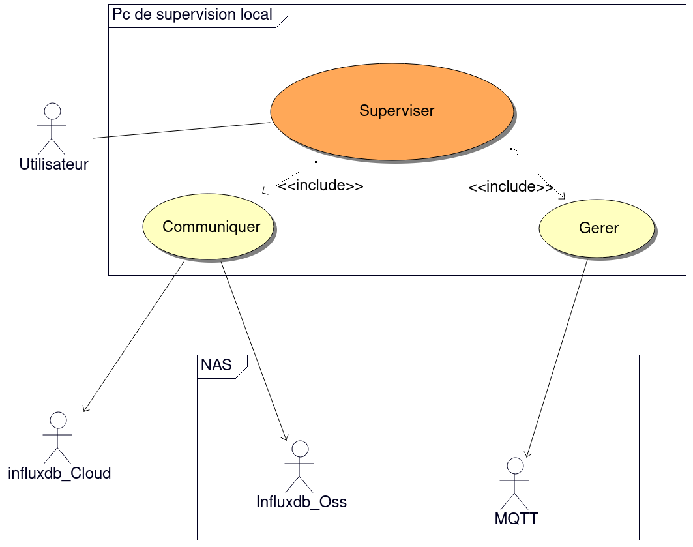<br><em>Cas d'utilisation</em><br><br>
  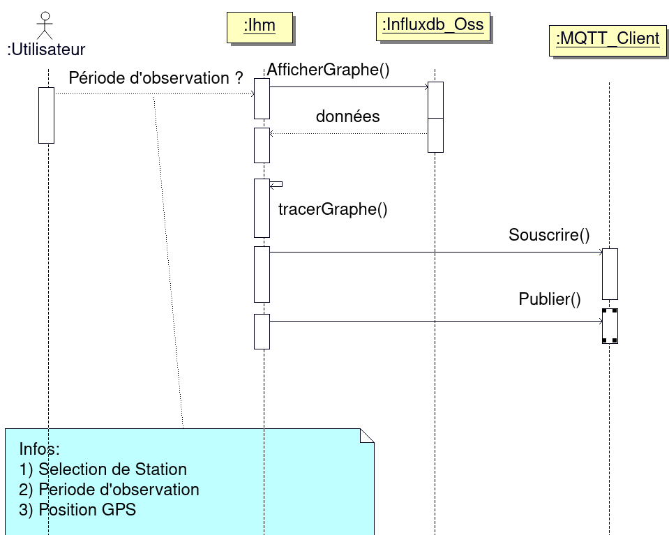<br><em>Séquence</em><br><br>
  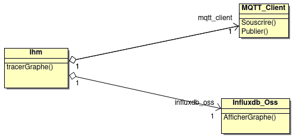<br><em>Classes</em><br><br>
  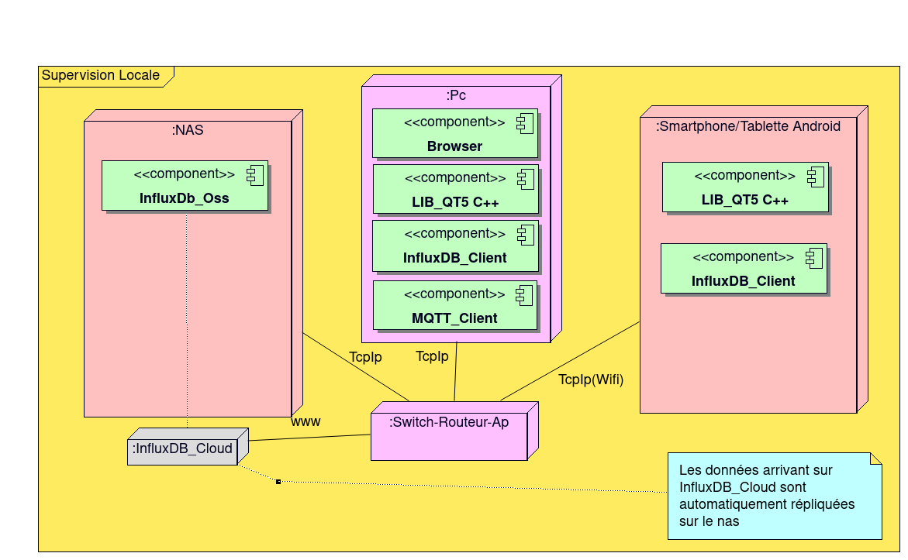<br><em>Déploiement</em>
</p>
</details>

<details>
<summary>English summary</summary>
<br>

RTMTR Sismique is a network of connected stations that measures ground vibrations and station position, then displays the readings as seismograms. It was the final technical project of a French two-year degree in computer systems and networks (BTS SNIR, 2023), built by a team of four in Martinique for the company Vision Informatique.

I built the local supervision application in C++ and Qt5. It reads measurements from InfluxDB with Flux queries, parses the returned CSV frames, plots the seismogram for a chosen period, shows the station position, and answers requests from the remote supervision over MQTT. The interface adapts to a PC or an Android tablet.
</details>
